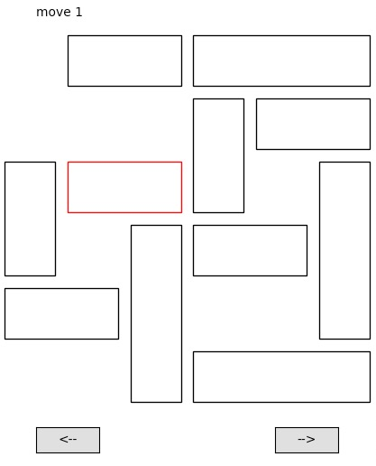

# unblock-car-puzzle-solver

Solves puzzles similar to *Unblock Me* and *Sliding Cars*, then lets you interact with an animation of the solution!

The solver can search for an optimal solution containing the fewest moves.

You can count each one-cell movement separately, or count consecutive movements of the same car as a single move.

To use, enter level information into solve.cpp, then compile and run solve.cpp to output a file containing the solution.
Then, to optionally help you view the solution, run animate.py for a quick animation and user-controlled mode (the matplotlib module is needed).

solve.cpp performs a brute-force search, yet it is **very fast** for many reasons: (1) *uniqueConfigurations* hash table prevents runtime from growing as exponentially, (2) I use compiled C++ instead of MATLAB or Python, (3) much data such as sol\[\] and *uniqueConfigurations* were made to be global, (4) the user can set the *nMax* parameter to limit search depth, (5) etc.

In 2026, I asked ChatGPT to try to speed up my code, and it easily did by making *uniqueConfigurations* a hash table, so I changed *uniqueConfigurations* to a hash table. It helped me understand that a breadth-first search would be most natural instead of my depth-first search, but my *uniqueConfigurations* and *nMax* reproduce the main advantages of a breadth-first search. ChatGPT also suggested various ways of reducing the amount of bits needed to be copied for each recursive step of move(), and it suggested representing puzzleState.s as a single uint64_t (4 bits per car), which would speed up hashing, but things are already plenty fast!